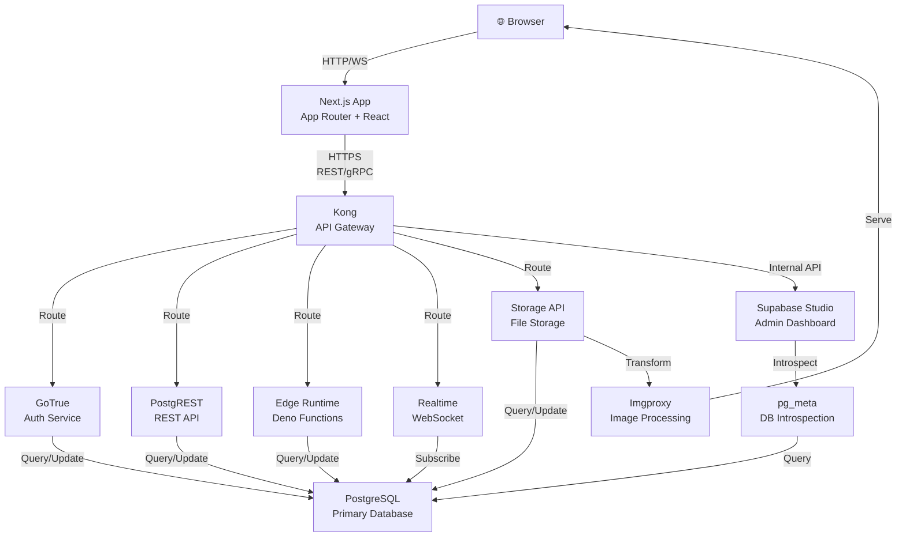

# Архитектура приложения

## Общая схема



## Компоненты архитектуры

### Frontend Layer
- **Next.js App** (TypeScript, App Router в `app/`)
  - Server Components для SSR
  - Client Components для интерактива
  - API Routes для server-side logic
  - Supabase Client для прямого доступа к БД (через RLS)

### API Gateway Layer
- **Kong** (3.9.3)
  - Маршрутизирует запросы к бэкенд сервисам
  - CORS, Rate Limiting, Auth plugins
  - Слушает на `127.0.0.1:8000` (dev) или приватный IP (prod)

### Backend Services Layer

#### Authentication & Authorization
- **GoTrue** (Supabase Auth v2.197.0)
  - JWT-based authentication
  - Email/Phone signup
  - OAuth integrations
  - Row Level Security (RLS) support

#### Data API
- **PostgREST** (v14.18)
  - Auto-generated REST API из PostgreSQL schema
  - Row Level Security enforcement
  - Filtering, pagination, aggregation

#### Serverless Functions
- **Edge Runtime** (Deno v2, v1.77.9)
  - Custom business logic
  - Files in `supabase/functions/`
  - Functions:
    - `main/` - health check
    - `create-note/` - note creation logic
  - Прямой доступ к Postgres через JWT

#### Realtime
- **Supabase Realtime** (v2.148.3)
  - WebSocket connections
  - Channel subscriptions
  - Real-time database changes

#### File Storage
- **Storage API** (v1.89.12)
  - File upload/download
  - Object storage
  - Signed URLs
  - Integration с Imgproxy для трансформации

#### Image Processing
- **Imgproxy** (v4.0.21)
  - On-the-fly image transformation
  - WebP conversion
  - Resizing, cropping

### Database Layer
- **PostgreSQL 17.6**
  - Primary database
  - Row Level Security (RLS) policies
  - Migrations in `supabase/migrations/`
  - Bootstrap schema in `infra/db/init/`

### Admin & Tooling
- **Supabase Studio** (2026.11.02)
  - Web UI для управления БД, Auth, Storage
  - Query Editor
  - Functions management
  
- **pg_meta** (v0.100.0)
  - Database introspection service
  - Used by Studio

## Data Flow

### Authentication Flow
```
Browser → Next.js App → GoTrue → Postgres
  ↓
JWT Token (stored in browser)
  ↓
Subsequent requests include JWT
  ↓
RLS policies in Postgres enforce access
```

### API Request Flow
```
Browser
  ↓
Next.js App (Server Component or API Route)
  ↓
Supabase Client or fetch()
  ↓
Kong (routes by path)
  ↓
PostgREST / Edge Function / Storage
  ↓
Postgres
  ↓
RLS policies check JWT
  ↓
Return data
```

### File Upload Flow
```
Browser → Next.js App → Storage API → Imgproxy
  ↓
File saved to storage volume
  ↓
Client requests resized/transformed image
  ↓
Imgproxy transforms on-the-fly
  ↓
Browser renders
```

## Security Considerations

- **Row Level Security (RLS)**: Every table has RLS policies
- **JWT Authentication**: All requests include JWT from Supabase Auth
- **Service Role Key**: Only in Edge Functions, never in browser
- **Anon Key**: Public key for unauthenticated access
- **HTTPS**: Enforced in production

## Deployment Architecture

### Local Development
- All services in Docker Compose (`infra/docker-compose.yml`)
- Kong exposes on `127.0.0.1:8000`
- Next.js on `127.0.0.1:3000`

### Production
- **SafeLine WAF** (v9.4.3+) in front
- Backend services on private `UPSTREAM_ADDR`
- Kong proxies to applications
- SonarQube for code quality gates

See `docs/production.md` for details.

## Development Environment Variables

Key environment variables in `infra/.env.example`:
- `JWT_SECRET` - JWT signing key
- `POSTGRES_PASSWORD` - Database password
- `ANON_KEY` - Public Supabase key
- `SERVICE_ROLE_KEY` - Admin Supabase key (server-only)
- `SUPABASE_URL` - Public Supabase endpoint
- `NEXT_PUBLIC_SUPABASE_ANON_KEY` - Frontend key (public)

## Stack Summary

| Layer | Technology | Version |
|-------|-----------|---------|
| Frontend | Next.js | Latest |
| Language | TypeScript | Everywhere |
| Auth | Supabase Auth (GoTrue) | v2.197.0 |
| API | PostgREST | v14.18 |
| Serverless | Deno (Edge Runtime) | v2 |
| Realtime | Supabase Realtime | v2.148.3 |
| Storage | Supabase Storage | v1.89.12 |
| Images | Imgproxy | v4.0.21 |
| Database | PostgreSQL | 17.6 |
| Gateway | Kong | 3.9.3 |
| Admin | Supabase Studio | 2026.11.02 |
| Container | Docker & Docker Compose | Latest |
